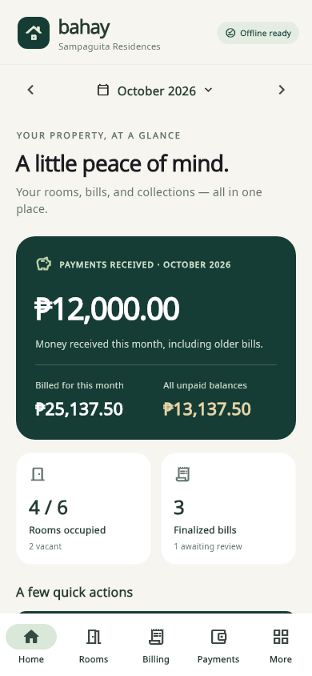

# Bahay Rent

A native Flutter Android application for a small Philippine rental property. The app uses SQLite on the phone and does not require an account, server, or internet connection. Currency is Philippine pesos; financial dates and reminder schedules use Asia/Manila.

## Install

Download the signed Android APK from the [latest GitHub release](https://github.com/Rizzpas/rent-tracker/releases/latest). A local release build also writes it to `deliverables/Bahay-Rent-1.0.0.apk`. Copy the APK to an Android phone running Android 7.0 or newer, open it, and allow installation from the app used to open the file. Keep the same application installed when applying updates; uninstalling removes its private records.



Screenshots use fictional test records. The installed application starts with an empty property.

## First use

1. Open **More**, tap your property name under **Property & preferences**, and enter your property information.
2. Open **Rooms → Add room**, enter rent and the electricity/water billing modes and rates.
3. Assign a tenant to the room, including their agreement, due day, and security deposit.
4. Select the billing month and open **Billing**. Enter the initial previous/current readings, or the fixed/shared charges. Save a draft, review it, then finalize it.
5. Open **Payments**, choose an outstanding invoice, and record a payment. Partial and multiple payments are supported. Generate a receipt from the transaction history.
6. Use **More** for reports, exports, reminders, app lock, and backups. Save a backup outside the app's private storage regularly.

The app starts with no example tenants or transactions. Room and tenant history is retained when someone moves out. Rooms are archived instead of deleting their financial history.

## Financial rules

- Monetary amounts are integer centavos. Readings are integer thousandths of a unit; usage charges are rounded once to the nearest centavo using integer arithmetic.
- Rent comes from the tenant's agreement. Fixed utilities use the configured amount; shared utilities accept each room's allocated share. The application does not infer how a property should split a shared master bill.
- There is one invoice per room per billing month. Rent is not automatically prorated. If a tenant changes mid-month after that room's bill is finalized, the incoming tenant's next invoice starts in the following billing month; settle the outgoing month's agreement before finalizing it.
- First readings accept an initial baseline. Later finalized periods use the previous finalized meter reading. Invalid readings and conflicting billing periods are rejected.
- Drafts can be reviewed and edited. Finalized invoice lines preserve their original rates and amounts. New rates affect future drafts only.
- A previous unpaid balance is a reference to existing invoices, never a second charge. Payments are allocated to individual finalized invoices. A late partial balance remains overdue.
- Payments received in a month are separate from charges billed for that month. Security deposits are held in their own ledger and are excluded from rent collection.
- A payment correction reverses the original transaction with a reason and an audit record. Record the correct payment as a new transaction. Original transactions remain visible.

## Backup and recovery

Export a backup through **More**, choose a device folder or removable storage, and optionally protect it with a password. Copy important backups to a second device or storage location. The file contains all rental, tenant, invoice, reading, payment, deposit, audit, and property setting records.

Restore validates the file and its financial relationships before showing a replacement confirmation. Replacement is atomic, and the app keeps a local safety copy of the records being replaced. Invalid files and incorrect passwords leave the current records intact. Restore replaces the current dataset; it does not merge two properties. Keep the password safe: encrypted backup passwords cannot be recovered. PIN/biometric credentials are device-specific and are not exported with property data.

SQLite files are stored in Android's private app sandbox. Automatic Android cloud backup is disabled. The optional app lock protects access through the app; it is not full database encryption. External plaintext backups and exported PDFs/CSVs should be stored appropriately. Password-protected backups use authenticated AES-GCM encryption with a randomly salted PBKDF2 key.

## Offline documents and reminders

PDF statements, receipts, reports, and CSV exports are created locally. Fonts are bundled. PDF viewing and saving work offline; printing depends on an installed Android print service and available printer. Sharing opens Android's share menu; the selected receiving application may need connectivity.

Reminders are local Android notifications. Enable them in More and grant notification permission when asked. Android may delay notifications under battery restrictions. Pending notifications are restored by the Android boot receiver. Reopen the app periodically so it can refresh future schedules and current balances. No SMS, email, or cloud messaging service is used.

## Development

Requirements: Flutter stable (developed with Flutter 3.47.9 / Dart 3.13.7), JDK 17, Android SDK platform/build tools 36, and Android NDK 28.2.13676358. Dependency downloads require internet during development; the installed application does not.

```powershell
flutter pub get
flutter analyze
flutter test
flutter run
```

Build the signed APK on Windows:

```powershell
powershell -ExecutionPolicy Bypass -File scripts/build-android.ps1
```

Pass `-FlutterSdk`, `-AndroidSdk`, and `-JavaHome` if needed. The script also recognizes the tools provisioned for this project under `%USERPROFILE%\.cache\rent_tracker_tools`. It runs analysis and tests before packaging and writes the APK and SHA-256 checksum to `deliverables`.

The first build creates a private release signing key under `%LOCALAPPDATA%\BahayRent\signing`, with access restricted to the current Windows account. Back up that entire folder securely: the same key is required to install future updates over this APK. `android/key.properties` is local and ignored by version control. Signing passwords and keys must never be committed.

Source layout:

- `lib/data`: SQLite repository, exact numeric parsing, and financial data helpers.
- `lib/ui`: dashboard, rooms and tenancies, billing, payments, and management screens.
- `lib/services`: documents, backup encryption, local app lock, and reminders.
- `test`: financial integrity, persistence, restoration, document, security, and UI tests.
- `docs/QA.md`: verification results and remaining device checks.

Bundled Noto Sans fonts are licensed under the SIL Open Font License; see `assets/fonts/OFL.txt`.
