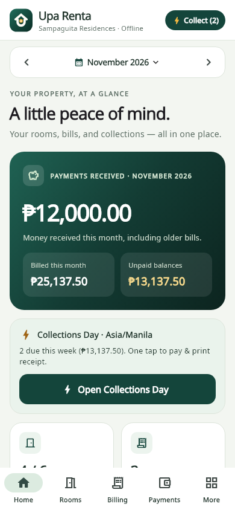

# Upa Renta

**Upa Renta** (`upa_renta`) is an offline-first Flutter Android rental ledger and utility billing application built for small Philippine apartment, boarding-house, and room-rental landlords. It runs smoothly on entry-level Android phones, stores all data locally in SQLite without requiring an online account or internet connection, prices everything in exact Philippine Pesos (`₱` integer centavos), and computes every due date, collection window, and reminder in `Asia/Manila` (`UTC+08:00`).

## Highlights

- **Collections Day (`< 3 taps`)**: Tap **`Collect`** in the top bar from any screen to see everyone due in the next 7 days (plus overdue follow-ups) in `Asia/Manila` time. Tap **`Pay & receipt`** once to record full payment and immediately generate an offline PDF receipt (**2 taps total from launch**), or tap **`Record paid`** followed by **`Receipt`**.
- **Philippine Due-Date Schedules (`Asia/Manila`)**: Built-in 1-tap presets and calendar math for **`5th`**, **`15th`**, **`30th`**, and **`End of month` (`31`)**—including automatic clamping for **February 28** in common years, **February 29** in leap years, and **30-day months** (April, June, September, November).
- **Custom Thumb-Friendly Date & Month Pickers**: Fast bottom-sheet `Asia/Manila` calendar and billing-month pickers with 1-tap `Today`, `5th`, `15th`, `30th`, and `End of month` presets, inline month/year jump grids, and clear weekday previews.
- **Engineered for Low-End Android Phones**: Zero `BackdropFilter` offscreen GPU blurs, single-active-tab widget instantiation, lazy `SliverList.builder` / `ListView.builder` history lists, `O(1)` in-memory relational indexing on `AppData`, SQLite secondary indexes, allocation-free Peso & date formatters, deduplicated/capped Android alarm IPC, and R8 code + resource shrinking.
- **Reliable Offline Notifications**: High-importance Android notification channel (`upa_renta_reminders`), Android 13+ runtime permission flow, `RECEIVE_BOOT_COMPLETED` alarm restoration with explicit R8 ProGuard keep rules, and a 1-tap **`Send test notification`** verification action in **More**.



Screenshots use isolated demonstration fixtures. Fresh installations start with an empty property ledger.

## Install

Download the signed Android APK (`Upa-Renta-1.0.0.apk`) or build it locally into `deliverables/Upa-Renta-1.0.0.apk`. Copy the APK to an Android phone running Android 7.0 (API 24) or newer, open it, and allow installation. Keep the application installed when applying updates; uninstalling removes private app-sandbox records unless backed up externally.

## First Use & Daily Workflow

1. Open **More**, tap your property name under **Property & preferences**, and enter your property name, address, and owner/landlady name for statements and receipts.
2. Open **Rooms → Add a room** to configure monthly rent and electricity/water billing modes (`Metered`, `Fixed`, or `Shared`).
3. Tap **Assign a tenant** on a room, select their due-date schedule (`5th`, `15th`, `30th`, `End of month`, or any day `1–31`), move-in date, agreed rent, and security deposit.
4. Open **Billing** for the selected month, enter meter readings or shared utility amounts, save a draft, review the breakdown, and **Finalize bill**.
5. On collection days, tap **`Collect`** in the top bar to open **Collections Day**:
   - Choose `Cash`, `GCash`, `Bank transfer`, or `Other` (defaults to `Cash`).
   - Tap **`Pay & receipt`** on a tenant card to record full payment and open the PDF receipt in **1 tap** (2 taps from app launch), or tap **`Partial / custom`** for installment payments.
6. Enable **Local reminders** in **More** and tap **Send test notification** to confirm notifications appear on your phone.
7. Save `.urbackup` backups outside the phone regularly via **More → Save backup** (optionally encrypted with a password).

## Financial & Ledger Rules

- **Exact Integer Arithmetic**: Monetary amounts are stored and calculated in integer centavos; meter readings use integer thousandths (`0.001` kWh / m³) with single-pass half-up centavo rounding using `BigInt` overflow guards.
- **Immutable Finalized Bills**: SQLite triggers lock finalized invoices, line items, and meter readings so later rent or utility rate edits affect future drafts only.
- **Derived Carry-Forward Balances**: Earlier unpaid balances stay on their original finalized bills and are never double-counted as new charges on later bills.
- **Separate Security Deposits**: Security deposits are tracked in their own ledger (`received`, `refund`, `deduction` after move-out) and never inflate rent collection totals.
- **Idempotent & Auditable Payments**: Duplicate taps are deduplicated via unique `request_id` keys. Corrections reverse the original payment with a mandatory reason and audit entry rather than deleting history.

## Backup & Recovery

Export `.urbackup` files via **More → Save backup** to Downloads, USB storage, or another device. Password-protected backups use PBKDF2-HMAC-SHA256 (`210,000` iterations) + authenticated `AES-GCM-256`. Upa Renta validates every relational and financial invariant in an isolated SQLite candidate database before atomic replacement, saves a pre-restore safety copy automatically, and maintains backward restore compatibility with legacy `.brbackup` archives.

## Development & Verification

Requirements: Flutter stable (verified with Flutter 3.47.9 / Dart 3.13.7), JDK 17, and Android SDK 36.

```powershell
flutter pub get
flutter analyze
flutter test
flutter run
```

Regenerate visual review screenshots:

```powershell
flutter test test/preview_test.dart --dart-define=EXPORT_PREVIEWS=true
```

Build the signed, R8-optimized release APK on Windows:

```powershell
powershell -ExecutionPolicy Bypass -File scripts/build-android.ps1
```

The build script runs `flutter analyze` and `flutter test`, signs the release APK using `%LOCALAPPDATA%\UpaRenta\signing`, and writes `deliverables/Upa-Renta-1.0.0.apk` plus `deliverables/SHA256SUMS.txt`.

## Source Layout

- `lib/main.dart`, `lib/app.dart`: Application entry point, low-overhead shell, custom month switcher, and 1-tap `Collect` header trigger.
- `lib/data/models.dart`: Exact fixed-point parser and `AppData` `O(1)` indexed ledger snapshot.
- `lib/data/repository.dart`: Transactional SQLite repository, immutability triggers, indexes, Manila due-date resolution, and backup validation.
- `lib/services/local_time.dart`: `Asia/Manila` (`UTC+08:00`) clock, leap-year calendar math, `5th`/`15th`/`30th`/`End-of-month` due-date engine, and collection-week helpers.
- `lib/services/documents.dart`: Offline PDF statements, receipts, summary reports, and formula-safe CSV exports.
- `lib/services/reminders.dart`: Android local notifications, high-importance channel setup, deduplicated scheduling, and test notifications.
- `lib/services/backup.dart`: Checksummed plaintext and `AES-GCM-256` encrypted `.urbackup` export/import.
- `lib/services/app_lock.dart`: Salted `PBKDF2` 6-digit PIN & biometric app lock with 30-second background relock.
- `lib/ui/`: `common.dart`, `date_picker.dart`, `collections_page.dart`, `home_page.dart`, `rooms_page.dart`, `billing_page.dart`, `payments_page.dart`, and `more_page.dart`.
- `test/`: Comprehensive unit, widget, financial-integrity, and 360px/1.3× accessibility layout tests for every module.

Bundled Noto Sans fonts are licensed under the SIL Open Font License (`assets/fonts/OFL.txt`).
